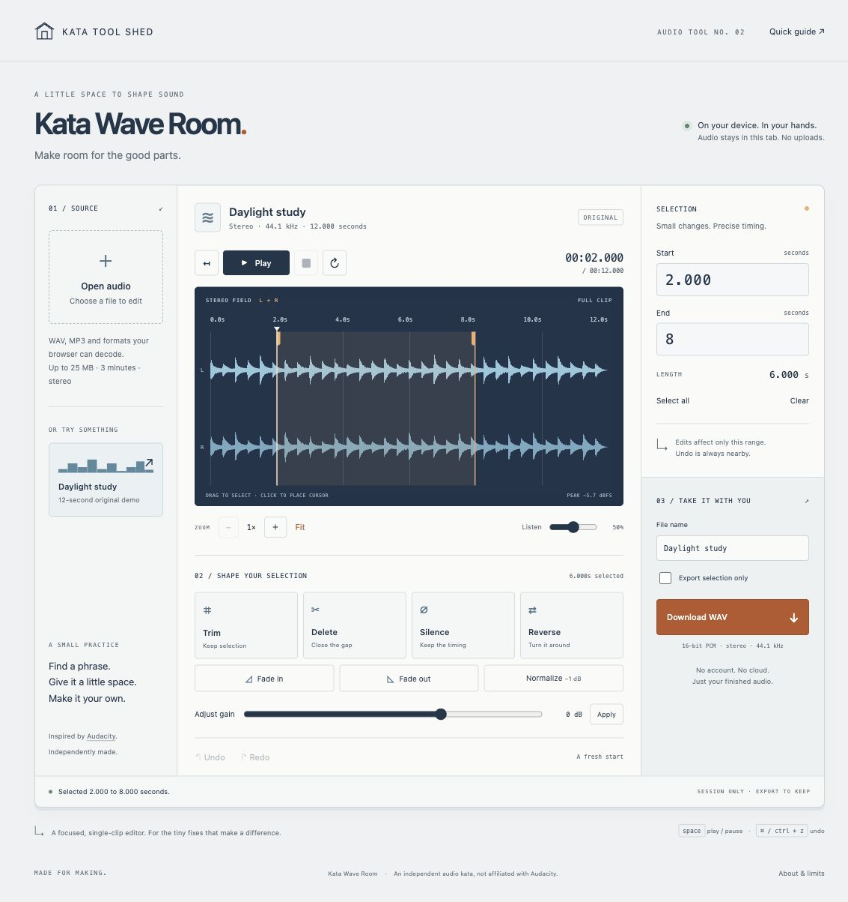

# Kata Wave Room

**Make room for the good parts.** An original, local-first browser audio editor inspired by the select → edit → listen → export workflow of [Audacity](https://www.audacityteam.org/). Made for [Kata Tool Shed](https://intrepion.github.io/tools/).



[Open the app](https://intrepion.github.io/kata-app-inspired-by-audacity-codex-dot/) · [Source repository](https://github.com/intrepion/kata-app-inspired-by-audacity-codex-dot)

## Run locally

Node.js 18 or newer. No installation, dependencies, account, or bundler required.

```sh
npm start
```

Open **http://127.0.0.1:4174/**. Always test through the HTTP server, never by opening `index.html` directly. The server binds to loopback. Another port: `PORT=4180 npm start` (PowerShell: `$env:PORT=4180; npm start`).

```sh
npm run check  # Syntax checks and 32 automated tests
npm run build  # Static files in dist/; does not publish anything
```

Assets use relative paths, including when hosted under a subdirectory. The GitHub Actions workflow checks and builds pushes and pull requests. After Pages is configured for Actions, pushes to `main` deploy the checked artifact.

## Your first edit

1. Try the original **Daylight study** demo, or choose **Open audio** for a local file.
2. Drag across the waveform, or enter **Start** and **End** in seconds. Click once to place a cursor. **Select all** selects the whole clip. Zoom and timeline scrolling help with smaller regions.
3. **Trim** keeps the selection. **Delete** removes it and closes the gap. **Silence** leaves timing intact. **Reverse**, **Fade in**, **Fade out**, **Normalize**, and **Adjust gain** act only on the selected range.
4. Listen with **Play**, **Pause**, **Stop**, and **Loop**. Undo/Redo let you compare. Playback volume changes only the monitoring level, not the exported audio. Begin with low device volume, particularly on headphones.
5. Name your sound and **Download WAV**. Optionally export only the selected region. Check your browser's download folder or save dialog.

Deleting a whole clip is disabled; use Silence instead. Fades are linear across exactly the selection. Normalize targets a shared channel peak of **−1 dBFS**, preserving stereo balance; this is not loudness normalization. Positive gain can clip and warns when samples reach full scale. Existing floating-point audio above full scale is preserved during unrelated edits but clipped to valid PCM on WAV export.

## Local data and limits

- Audio is processed in this tab with Web Audio. The app uploads nothing and uses no analytics, third-party assets, account, backend, or remote audio service.
- Work is **session-only**, not automatically saved. Reloading or closing the tab loses edits. Export WAV to retain audio; no editable project format is provided.
- Up to 40 undo snapshots within a 128 MiB history budget. Older steps can be discarded. Changing the source clears history after a replacement confirmation if the clip was edited.
- One mono/stereo clip, up to 3 minutes, a 25 MiB encoded-file limit, and 64 MiB decoded PCM. Browser decoding happens before decoded-size validation, so highly compressed input can temporarily exceed that allocation.
- Import formats depend on the browser: WAV/MP3 are typical; M4A, OGG, FLAC, and AAC support varies. Decoding may resample to the browser AudioContext's sample rate, which the UI and export report.
- Export is **16-bit PCM WAV**, mono or stereo at the decoded sample rate. No MP3 export, multitrack timeline, recording, plugins, noise removal, cloud projects, or `.aup`/`.aup3`/`.aup4` compatibility.
- No offline-cache/service-worker promise. Serving the local app works without internet; hosted app availability depends on the host.

## Keyboard and accessibility

Named buttons and labeled number/range inputs provide alternatives to waveform dragging. Status changes use a polite live region. Native dialogs trap focus, and visible focus styles and reduced-motion preferences are supported.

- **Space:** play/pause outside buttons and text fields.
- **Escape:** stop playback, or dismiss an open guide/replace dialog.
- **Ctrl/⌘ Z:** undo. **Ctrl/⌘ Shift Z** or **Ctrl/⌘ Y:** redo.
- **Ctrl/⌘ A:** select all audio outside editable fields.

## Verification

See [QA notes](docs/QA.md), [desktop screenshot](docs/screenshots/desktop.jpg), [narrow screenshot](docs/screenshots/mobile.jpg), and [screenshot provenance](docs/screenshots/manifest.json). Screenshots are genuine, unedited Chrome captures of the localhost app. The narrow screen is a 390 CSS-pixel browser viewport, not a physical phone test. Test results do not imply Safari, Firefox, mobile audio, or screen-reader certification.

## Project structure

- `src/audio.js`: pure PCM validation, immutable edits, deterministic stereo demo, statistics, and WAV encoding.
- `src/selection.js`: partial numeric selection input rules.
- `src/app.js`: waveform, Web Audio playback, import/export UI, history, dialogs and shortcuts.
- `tests/`: 27 audio tests, four numeric-selection regressions, and HTTP server integration.
- `app.json`: Kata Tool Shed catalog metadata.

## Inspiration, credits and license

Audacity's official [editing tutorial](https://support.audacityteam.org/basics/audacity-editing), [selection manual](https://manual.audacityteam.org/man/audacity_selection.html), [edit toolbar documentation](https://manual.audacityteam.org/man/edit_toolbar.html), and [WAV export documentation](https://manual.audacityteam.org/man/wav_export_options.html) informed the focused workflow. No Audacity code, branding, artwork, or audio was copied. This is an independent implementation and not an Audacity port, replacement, or affiliated product.

Original source, UI assets, and procedural demo are [MIT licensed](LICENSE). Imported audio remains subject to the rights of its owner. The app adds no restrictions to audio you create or edit.
